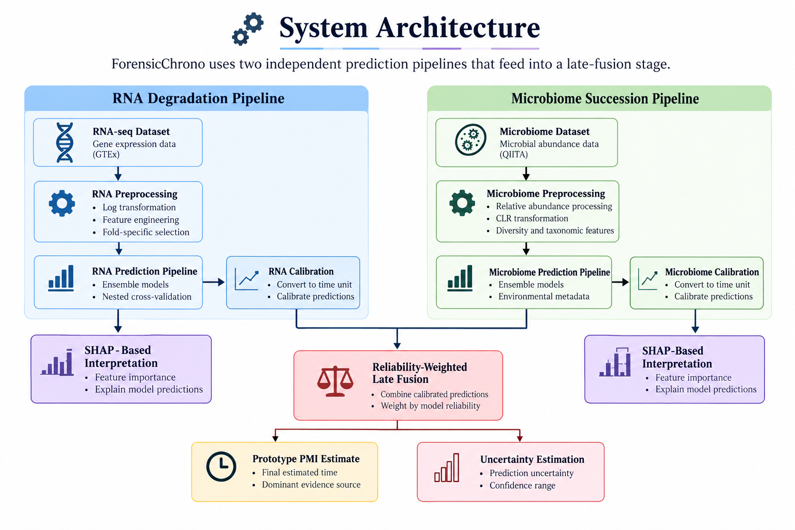

# 🧬 ForensicChrono

### AI-Driven Postmortem Interval Estimation Using RNA Degradation and Microbial Succession

ForensicChrono is an AI-powered research project that explores postmortem interval (PMI) estimation using two biological signals: **RNA degradation** and **postmortem microbial succession**. It integrates machine learning, biological feature engineering, explainable AI, and reliability-weighted late fusion to generate a prototype PMI estimate.

## ✨ Key Features

- 🧬 **RNA Degradation Analysis** — Predicts ischemic time from gene-expression patterns.
- 🦠 **Microbial Succession Analysis** — Estimates PMI using microbial abundance and diversity patterns.
- 🔗 **Multimodal Late Fusion** — Combines calibrated predictions from the two independent models.
- 🔍 **SHAP-Based Interpretation** — Examines the contribution of model features to predictions.
- 📊 **Uncertainty Estimation** — Provides estimated prediction uncertainty.
- 🖥️ **Interactive Dashboard** — Displays predictions and model outputs through a user-friendly interface.

## 🏗️ System Architecture

ForensicChrono uses two independent prediction pipelines that feed into a late-fusion stage.

## 📈 Model Performance

### RNA Prediction Model

| Metric | Result |
|---|---:|
| Samples | 2,470 |
| R² Score | 0.7267 |
| Mean Absolute Error | 124.7 minutes |

### Microbiome Prediction Model

| Metric | Result |
|---|---:|
| Samples | 1,810 |
| R² Score | 0.9478 |
| Mean Absolute Error | 0.987 days |

## 🛠️ Technologies Used

- Python
- Pandas and NumPy
- Scikit-learn
- XGBoost
- SHAP
- Streamlit
- RNA-sequencing data analysis
- Microbiome data analysis
- Machine learning and ensemble modeling

## 🎯 Project Objective

To explore how complementary molecular signals—RNA degradation and microbial succession—can be integrated into a machine-learning framework for postmortem interval estimation.

---

**ForensicChrono** | Exploring molecular evidence through AI-driven forensic analysis.
